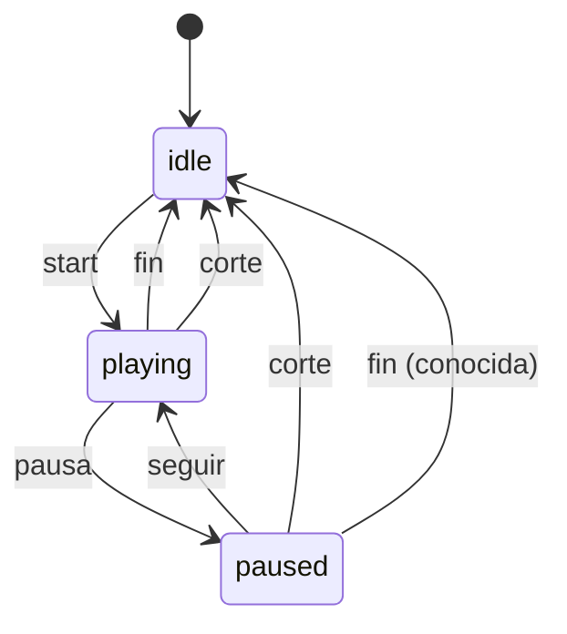
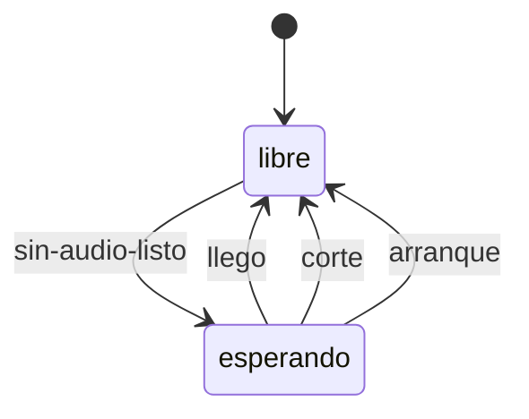
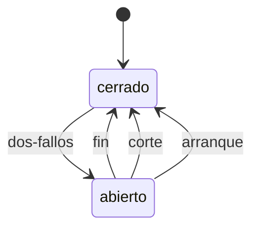

# Máquinas de estado

> **Generado por `tools/gen-maquinas.js` a partir de las tablas que declara el código. No se edita a mano:** `node tools/gen-maquinas.js` lo regenera y `tools/check-maquinas.js` falla si está desactualizado.

Cada máquina es una tabla `from → to · evento` declarada con `acMachine(...)` (`state-machine.js`, compartido, sin dependencias). El estado solo cambia con `máquina.go(estado, evento)`; una asignación directa (`L.state = 'x'`) la frena el chequeo estático.

- **Modo estricto: SOLO en pruebas** (`window.AC_SM_STRICT = true`): una transición no declarada lanza. **En producción** se registra en `window.AC_SM_LOG` y se aplica igual.
- Si `state-machine.js` no carga, el módulo usa una máquina de respaldo que asigna sin validar: la app suena igual, solo se pierde la validación.
- Las filas **⚠️ conocida** son defectos de hoy declarados a propósito: describen lo que el código hace ahora (la prueba de oro por orden de eventos lo fija); arreglarlos es un cambio aparte.
- Los tokens de cancelación (`L.tok`, `audioReqTok`, …) NO son estado: identifican «una corrida».

## «Escuchar todo» (lecciones de aprendo chino)

Archivo: `lessons-listen.js` · prueba de oro: `tests/escuchar-todo-oro.test.js` (`tests/data/escuchar-todo-oro.json`).

### «Escuchar todo»: reproducción (`escuchar.reproduccion`)

Estados: `idle`, `playing`, `paused` · inicial: `idle`

| De | A | Evento | Estado de la fila | Qué es |
|---|---|---|---|---|
| `idle` | `playing` | `start` | declarada | ▶ Escuchar todo |
| `playing` | `paused` | `pausa` | declarada | ⏸ Pausar (también durante la espera de un audio) |
| `paused` | `playing` | `seguir` | declarada | ▶ Seguir |
| `playing` | `idle` | `fin` | declarada | se leyó la última línea |
| `playing`, `paused` | `idle` | `corte` | declarada | un corte (ver la tabla de cortes) |
| `paused` | `idle` | `fin` | ⚠️ **conocida** (pausa-muda) | si la última línea se lee sin voz (la voz del sistema no arranca), el tiempo de lectura sigue corriendo en pausa y la lección termina estando en pausa |

Defectos conocidos de esta máquina (no son transiciones; el oro los fija tal cual):

- ⚠️ **R5** — la pausa llega en el mismo instante en que arranca un audio: play() se rechaza con AbortError, la línea cae a la voz del sistema y SUENA estando en pausa (no es una transición: es un efecto dentro de «paused») Escenario del oro: `R5-pausa-al-arrancar`.

### «Escuchar todo»: espera del audio (`escuchar.espera`)

Estados: `libre`, `esperando` · inicial: `libre`

| De | A | Evento | Estado de la fila | Qué es |
|---|---|---|---|---|
| `libre` | `esperando` | `sin-audio-listo` | declarada | a la línea que toca todavía no le llegó el audio |
| `esperando` | `libre` | `llego` | declarada | llegó el audio (o el error): se sigue |
| `esperando` | `libre` | `corte` | declarada | un corte mientras esperaba |
| `esperando` | `libre` | `arranque` | declarada | defensa: start() deja la espera limpia (no debería haber nada en espera con la reproducción en reposo) |

### «Escuchar todo»: circuito del servidor de voz (`escuchar.circuito`)

Estados: `cerrado`, `abierto` · inicial: `cerrado`

| De | A | Evento | Estado de la fila | Qué es |
|---|---|---|---|---|
| `cerrado` | `abierto` | `dos-fallos` | declarada | CIRCUIT_AFTER líneas seguidas fallidas: no se pide nada más |
| `abierto` | `cerrado` | `fin` | declarada | termina la lección: el próximo «Escuchar todo» empieza con el circuito cerrado |
| `abierto` | `cerrado` | `corte` | declarada | un corte |
| `abierto` | `cerrado` | `arranque` | declarada | defensa: start() deja el circuito cerrado (cada lección empieza de cero) |

### Cortes (`stopAll(motivo)`)

Todo lo que para la escucha pasa por `stopAll(motivo)` con uno de estos motivos; cada uno lleva a `idle` / `libre` / `cerrado` con el evento `corte`.

| Motivo | Qué lo dispara |
|---|---|
| `boton` | ⏹ Parar |
| `cerrar` | ✕ y Atrás (#lq-close) |
| `escritura` | cambio 简/繁 (ac-script-change) |
| `linea` | 🔊 de una línea |
| `practicar` | Practicar → quiz |
| `ventana` | Esc o clic en el fondo (lesson-pop se oculta) |
| `vista` | la vista cambió (quiz, glosario, otra lección) |
| `api` | LQ_LISTEN.stop() |
