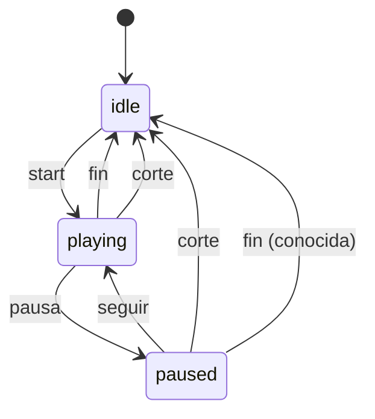
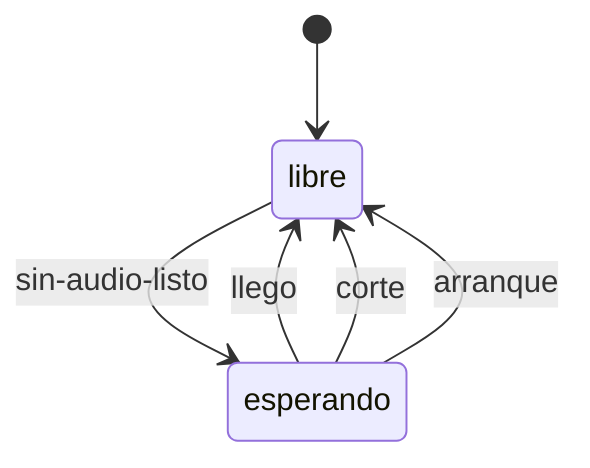
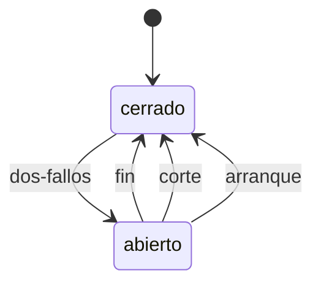
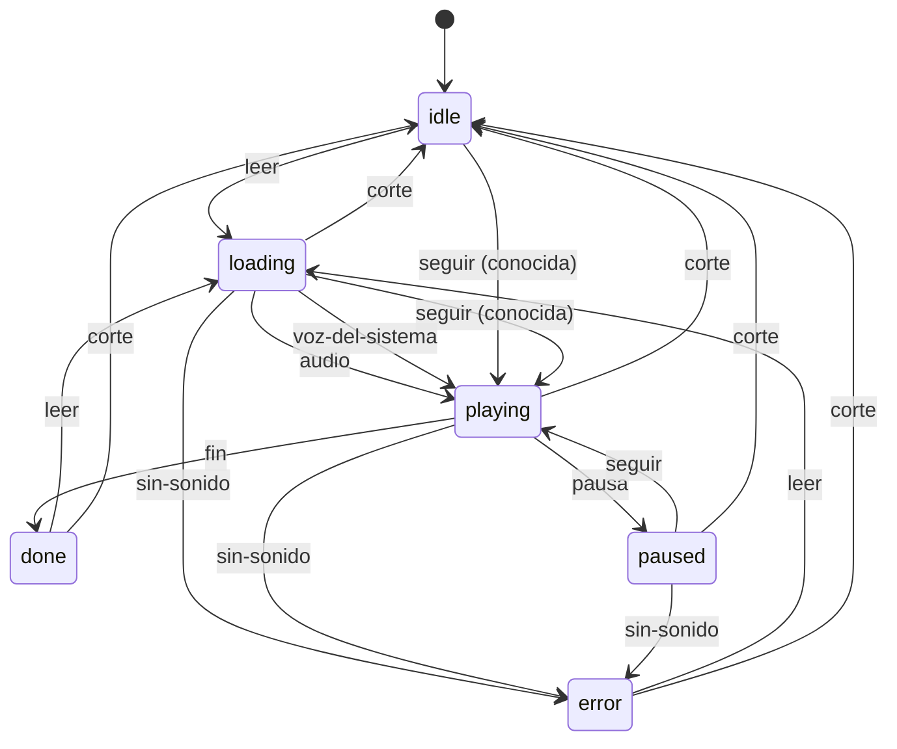
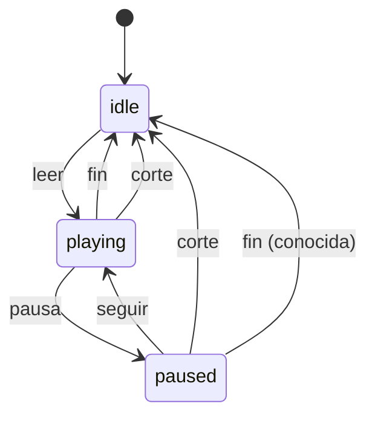
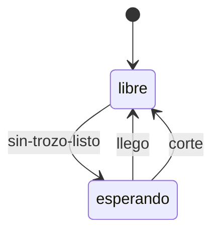
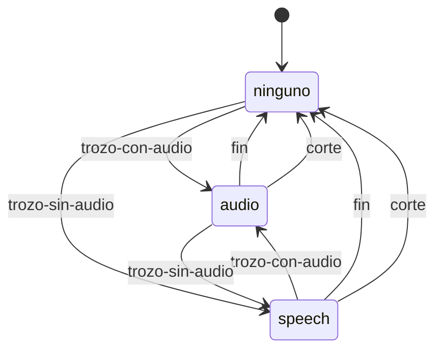

# Máquinas de estado

> **Generado por `tools/gen-maquinas.js` a partir de las tablas que declara el código. No se edita a mano:** `node tools/gen-maquinas.js` lo regenera y `tools/check-maquinas.js` falla si está desactualizado.

Cada máquina es una tabla `from → to · evento` declarada con `acMachine(...)` (`state-machine.js`, compartido, sin dependencias). El estado solo cambia con `máquina.go(estado, evento)`; una asignación directa (`L.state = 'x'`) la frena el chequeo estático.

- **Modo estricto: SOLO en pruebas** (`window.AC_SM_STRICT = true`): una transición no declarada lanza. **En producción** se registra en `window.AC_SM_LOG` y se aplica igual.
- Si `state-machine.js` no carga, el módulo usa una máquina de respaldo que asigna sin validar: la app suena igual, solo se pierde la validación.
- Las filas **⚠️ conocida** son defectos de hoy declarados a propósito: describen lo que el código hace ahora (la prueba de oro por orden de eventos lo fija); arreglarlos es un cambio aparte.
- Los tokens de cancelación (`L.tok`, `audioReqTok`, …) NO son estado: identifican «una corrida».

## «Escuchar todo» (lecciones de aprendo chino)

Archivo: `lessons-listen.js` · prueba de oro: `tests/escuchar-todo-oro.test.js` (`tests/data/escuchar-todo-oro.json`).

### «Escuchar todo»: reproducción (`escuchar.reproduccion`)

Estados: `idle`, `playing`, `paused` · inicial: `idle`

| De | A | Evento | Estado de la fila | Qué es |
|---|---|---|---|---|
| `idle` | `playing` | `start` | declarada | ▶ Escuchar todo |
| `playing` | `paused` | `pausa` | declarada | ⏸ Pausar (también durante la espera de un audio) |
| `paused` | `playing` | `seguir` | declarada | ▶ Seguir |
| `playing` | `idle` | `fin` | declarada | se leyó la última línea |
| `playing`, `paused` | `idle` | `corte` | declarada | un corte (ver la tabla de cortes) |
| `paused` | `idle` | `fin` | ⚠️ **conocida** (pausa-muda) | si la última línea se lee sin voz (la voz del sistema no arranca), el tiempo de lectura sigue corriendo en pausa y la lección termina estando en pausa |

### «Escuchar todo»: espera del audio (`escuchar.espera`)

Estados: `libre`, `esperando` · inicial: `libre`

| De | A | Evento | Estado de la fila | Qué es |
|---|---|---|---|---|
| `libre` | `esperando` | `sin-audio-listo` | declarada | a la línea que toca todavía no le llegó el audio |
| `esperando` | `libre` | `llego` | declarada | llegó el audio (o el error): se sigue |
| `esperando` | `libre` | `corte` | declarada | un corte mientras esperaba |
| `esperando` | `libre` | `arranque` | declarada | defensa: start() deja la espera limpia (no debería haber nada en espera con la reproducción en reposo) |

### «Escuchar todo»: circuito del servidor de voz (`escuchar.circuito`)

Estados: `cerrado`, `abierto` · inicial: `cerrado`

| De | A | Evento | Estado de la fila | Qué es |
|---|---|---|---|---|
| `cerrado` | `abierto` | `dos-fallos` | declarada | CIRCUIT_AFTER líneas seguidas fallidas: no se pide nada más |
| `abierto` | `cerrado` | `fin` | declarada | termina la lección: el próximo «Escuchar todo» empieza con el circuito cerrado |
| `abierto` | `cerrado` | `corte` | declarada | un corte |
| `abierto` | `cerrado` | `arranque` | declarada | defensa: start() deja el circuito cerrado (cada lección empieza de cero) |

### Cortes (`stopAll(motivo)`)

Todo lo que para la escucha pasa por `stopAll(motivo)` con uno de estos motivos; cada uno lleva a `idle` / `libre` / `cerrado` con el evento `corte`.

| Motivo | Qué lo dispara |
|---|---|
| `boton` | ⏹ Parar |
| `cerrar` | ✕ y Atrás (#lq-close) |
| `escritura` | cambio 简/繁 (ac-script-change) |
| `linea` | 🔊 de una línea |
| `practicar` | Practicar → quiz |
| `ventana` | Esc o clic en el fondo (lesson-pop se oculta) |
| `vista` | la vista cambió (quiz, glosario, otra lección) |
| `api` | LQ_LISTEN.stop() |

## Podcast (lecciones de corrido)

Archivo: `podcast.js` · prueba de oro: `tests/podcast-oro.test.js` (`tests/data/podcast-oro.json`).

### Podcast: reproducción (`podcast.reproduccion`)

Estados: `idle`, `done`, `error`, `loading`, `playing`, `paused` · inicial: `idle`

| De | A | Evento | Estado de la fila | Qué es |
|---|---|---|---|---|
| `idle`, `done`, `error` | `loading` | `leer` | declarada | se elige una lección (arranca sola) o se toca ▶️ tras «Listo» o tras «No pude reproducir el audio» |
| `loading` | `playing` | `audio` | declarada | llegó el audio del servidor y arranca |
| `loading` | `playing` | `voz-del-sistema` | declarada | el pedido o el play() falló: la lección se lee por FRASES con la voz del sistema; se pasa a «playing» cuando la primera frase EMPIEZA a sonar (onstart) o, en un motor que no lo dispara, cuando termina (onend) tras ≥300 ms |
| `loading`, `playing`, `paused` | `error` | `sin-sonido` | declarada | no suena nada: el dispositivo no tiene voz, la voz del sistema dio un error (distinto de canceled/interrupted), no arrancó en ~5 s, terminó al instante sin hablar, o el audio del servidor falló ya sin sonar. NUNCA pasa a «Listo» |
| `playing` | `paused` | `pausa` | declarada | ⏸ (con la voz del sistema: se corta la frase en curso y «Seguir» la retoma desde su INICIO) |
| `paused` | `playing` | `seguir` | declarada | ▶️ tras una pausa |
| `playing` | `done` | `fin` | declarada | terminó el audio (o la última frase de la voz del sistema, habiendo sonado) |
| `loading`, `playing`, `paused`, `done`, `error` | `idle` | `corte` | declarada | stopAll(): ✕, Esc, clic afuera, ☰ Elegir otra, ⏮/⏭ y elegir otra lección |
| `idle`, `loading` | `playing` | `seguir` | ⚠️ **conocida** (R10a) | CLASE sintética (dos toques en la MISMA tarea; una persona no puede). El .then de play() al reanudar no tiene guarda de token: tras cerrar / ☰ / ⏭ en el mismo turno vuelve a poner «playing» (en idle, sin efecto visible) o lo pone con la lección nueva todavía cargando (loading: la pantalla dice «Reproduciendo» sin que suene nada). Escenarios R10a-* |

## Lector de texto libre

Archivo: `reader.js` · prueba de oro: `tests/lector-oro.test.js` (`tests/data/lector-oro.json`).

### Lector: reproducción (`lector.reproduccion`)

Estados: `idle`, `playing`, `paused` · inicial: `idle`

| De | A | Evento | Estado de la fila | Qué es |
|---|---|---|---|---|
| `idle` | `playing` | `leer` | declarada | 🔊 Leer: arranca una lectura nueva |
| `playing` | `paused` | `pausa` | declarada | ⏸ Pausar (también mientras carga un trozo) |
| `paused` | `playing` | `seguir` | declarada | ▶ Continuar |
| `playing` | `idle` | `fin` | declarada | se leyó el último trozo |
| `playing`, `paused` | `idle` | `corte` | declarada | stopReader(): lo llaman Limpiar, otra lectura/audio de la app (un solo audio a la vez) y toggleReaderPlay() al arrancar |
| `paused` | `idle` | `fin` | ⚠️ **conocida** (pausa-ignorada) | si el motor de voz del sistema ignora pause() (la voz sigue y termina sola), el último trozo termina estando en pausa y la lectura vuelve al reposo sin que nadie siga (escenario pausa-voz-ignora-pausa) |

### Lector: espera del trozo (`lector.espera`)

Estados: `libre`, `esperando` · inicial: `libre`

| De | A | Evento | Estado de la fila | Qué es |
|---|---|---|---|---|
| `libre` | `esperando` | `sin-trozo-listo` | declarada | al trozo que toca todavía no le llegó el audio |
| `esperando` | `libre` | `llego` | declarada | llegó el audio (o el error): se sigue |
| `esperando` | `libre` | `corte` | declarada | stopReader() mientras esperaba |

### Lector: motor de voz (`lector.motor`)

Estados: `ninguno`, `speech`, `audio` · inicial: `ninguno`

| De | A | Evento | Estado de la fila | Qué es |
|---|---|---|---|---|
| `ninguno`, `speech` | `audio` | `trozo-con-audio` | declarada | el trozo suena con el audio del servidor |
| `ninguno`, `audio` | `speech` | `trozo-sin-audio` | declarada | el trozo falló: se lee con la voz del sistema |
| `audio`, `speech` | `ninguno` | `fin` | declarada | se leyó el último trozo |
| `audio`, `speech` | `ninguno` | `corte` | declarada | stopReader() |
